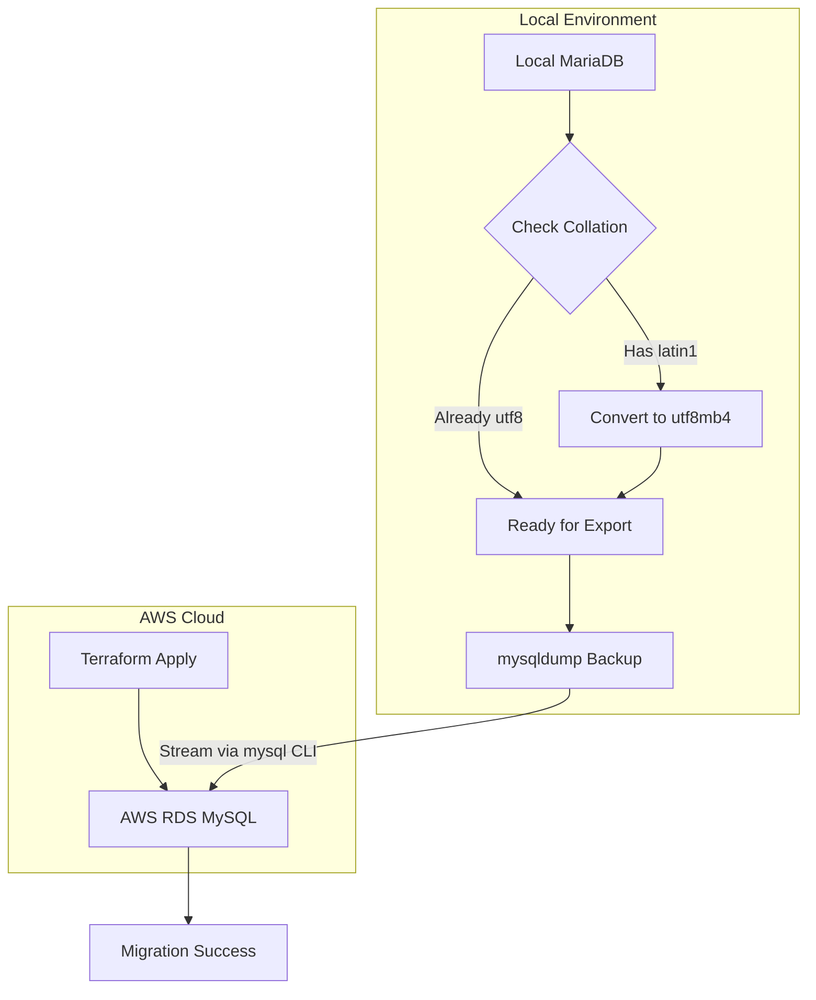

# Local-to-Cloud Enterprise Database Migration Pipeline

A robust, automated database migration pipeline that provisions a secure AWS RDS MySQL instance using Terraform, detects and remediates legacy table encodings from a local MariaDB database, dumps the data via mysqldump, and streams it over the wire to the cloud target.

---

## Architecture & Workflow

Project Structure
generate_data.py: Generates 10,000 mock ledger entries with legacy latin1 encoding.

main.tf: Terraform configuration for VPC, subnets, and RDS.

execute_migration.py: Automated pipeline script for collation check, dump, and stream.

README.md: Project documentation.

Step-by-Step Execution Guide
Generate Local Mock Data:

python3 generate_data.py
Provision AWS RDS Infrastructure:

terraform init
terraform apply -auto-approve
Run the Migration Pipeline:
Update the AWS_RDS_ENDPOINT in execute_migration.py with your Terraform output, then run:

python3 execute_migration.py
Cleanup (Teardown):

terraform destroy -auto-approve
    
